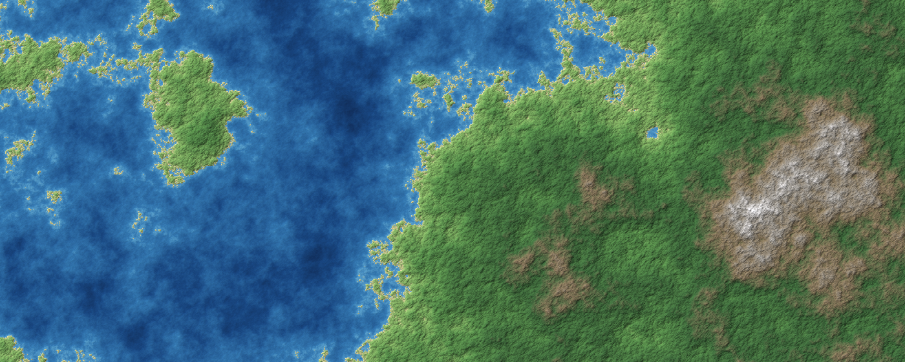

# FastMap

FastMap quickly and realistically generates elevation for every hex of an unbounded hex grid. Built in near-pure Rust, it aims for maximum achievable performance: optimized FFTs, SIMD-accelerated mathematics, caching, hash-based noise generation, and GPU rendering.

**[▶ Live demo](https://jclederman.github.io/fastmap/)** · **[How it works](docs/method.md)**



## Overview

The elevation map is white noise convolved with a power-law kernel, giving uniform, isotropic fractal terrain with a maximum feature size configurable up to 2500 hexes.
 - The map is generated in 128 × 128 rhombic blocks using overlap-save
 - Three coarse elevation levels, on grids with spacings of 8, 64 and 512 hexes, implement larger-scale features. Their power spectral densities combine with that of the fine elevation level to produce a smooth power law that rolls off at the maximum feature size
 - A tile costs one FFT pair plus cached coarse tiles: on the author's machine, ~0.2 ms per 16k-hex tile natively and ~0.5 ms in the browser. Changing the kernel reuses each tile's cached noise spectrum
 - Smoothness (β), largest feature size (R), and land fraction are real-time configurable
 - The map is produced deterministically from a seed and the parameters
 - The compressed WebGPU build is about 265 KB. The WebGL2 build is fetched only when WebGPU is unavailable

[How it works](docs/method.md) covers the theory and each step in detail.

## Build and Run

A Rust toolchain from [rustup.rs](https://rustup.rs) is required.

```bash
# Native viewer (--help lists keys and options)
cargo run --release -p fastmap-viewer

# Tests, the tile benchmark, and the realized spectrum for β = 1.5, R = 1000
cargo test --release
cargo run --release -p fastmap-core --example bench
cargo run --release -p fastmap-core --example spectrum -- 1.5 1000
```

To build the browser demo:

```bash
rustup target add wasm32-unknown-unknown
cargo install --locked wasm-bindgen-cli --version 0.2.130   # must match Cargo.lock
cargo xtask web --serve                                     # http://localhost:8080
```

[`wasm-opt`](https://github.com/WebAssembly/binaryen) is optional but recommended. Put it on `PATH`, or set `WASM_OPT=/path/to/wasm-opt`.

The page selects a build at load time: WebGPU when the browser has an adapter, and WebGL2 otherwise. Desktop Linux defaults to WebGL2, because WebGPU there is still experimental and presents frames with noticeable lag. Add `?backend=webgpu` or `?backend=webgl` to the URL to override the choice.

## Rendering

GPU rendering is optimized:
 - Each tile is uploaded once, as one layer of an `R32Float` texture array
 - Each tile is drawn as a single instanced rhombus
 - The fragment shader rounds each pixel to its hex, reads that hex's elevation, and shades it. A view change only updates a few uniforms
 - The color palette and the shader's lattice constants are computed at compile time, and compile-time checks confirm that the shader's constants match the Rust ones

The browser build ships as two variants, WebGPU and WebGL2. A small loader in `index.html` selects one.

## Layout

| Path | Contents |
|---|---|
| `crates/core` | `fastmap-core`: noise, kernels, 2D real FFT, overlap-save tiles, coarse levels. No GPU or web dependencies |
| `crates/render` | `fastmap-render`: wgpu renderer, camera, tile scheduler |
| `crates/viewer` | Native viewer and headless `--screenshot` renderer, used for the figures in `docs/` |
| `crates/web` | Browser front end: controls, input, URL state, performance panel |
| `web/` | Static page and the WebGPU/WebGL2 loader |
| `xtask/` | `cargo xtask web`: builds both wasm variants into `dist/` and serves them |

To use the core library directly:

```rust
use fastmap_core::{Generator, Params, TileCoord};

let mut generator = Generator::new();
let tile = generator.tile(42, Params::default(), TileCoord::new(0, 0));
let h = tile.get(10, 20); // elevation of hex (10, 20), in standard deviations
```

## License and Contact

Copyright © 2026 Joshua C. Lederman.

The code is licensed under the [GNU Affero General Public License v3.0 or later](LICENSE). The documentation and images in `docs/` are licensed under [CC BY-SA 4.0](https://creativecommons.org/licenses/by-sa/4.0/).

Questions or comments about the project: joshclederman@gmail.com.
