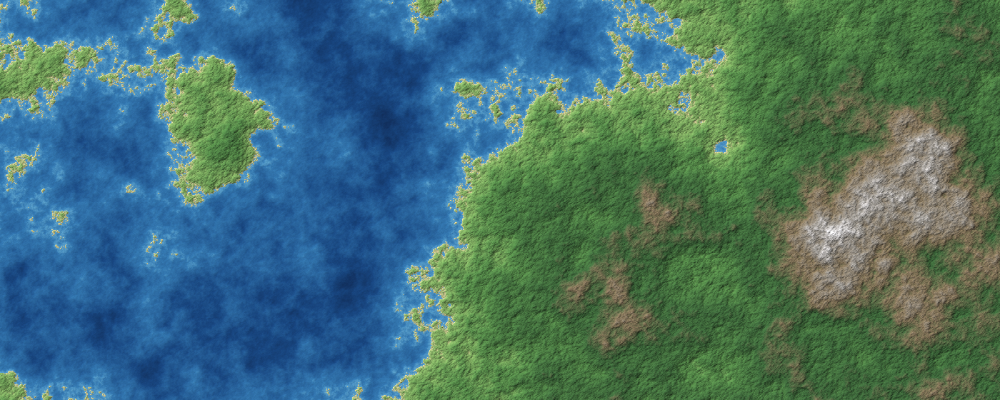
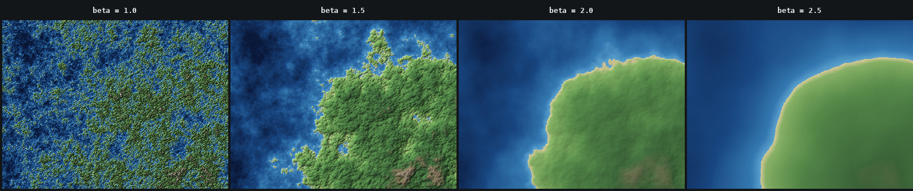
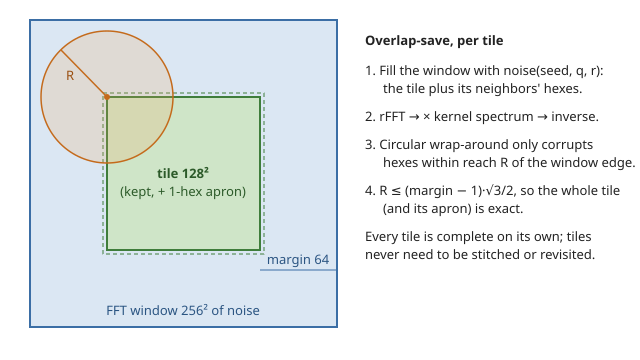
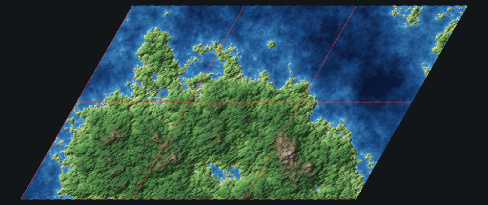

# How FastMap works

## 1. Theory

Real terrain is approximately fractal, with similar features at a wide range of scales. Height and width don't scale together, however. A patch of land half the width as the original might have height variation that is 1.5 times the original. In general, width scaling by $N$ is associated with height scaling by $N^H$, where $H$ is the **Hurst exponent**.

This is easiest to model in the spectral domain. The 2D Fourier transform for the real spatial domain elevation map $h(\mathbf x)$ is the complex spectral domain representation $\tilde H(\boldsymbol\kappa)$, for position $\mathbf x$, wavevector $\boldsymbol\kappa$. We expect the following:
 - Phase $\angle \tilde H(\boldsymbol\kappa)$ is random, uniformly distributed, and independent for any $\boldsymbol\kappa$
 - Expected amplitude follows a power law: $\mathrm E(|\tilde H(\boldsymbol\kappa)|) \propto |\boldsymbol\kappa|^{-\beta}$

A power law has no built-in length scale, which ensures the field looks the same at every scale. $\beta$, linked to the Hurst exponent as $H = \beta - 1$, determines the roughness of the terrain, illustrated as follows:

FastMap (unrealistically) uses uniform, isotropic $\beta$ across the map at all scales.

## 2. Discrete Representation

### Spatial Representation

A hex grid is a hexagonal lattice, addressed by axial coordinates $(q, r)$ with basis vector $\mathbf a_0$ and $\mathbf a_1$ as follows:

$$\mathbf p = q\,\mathbf a_0 + r\,\mathbf a_1 \qquad \mathbf a_0 = (1, 0)\quad \mathbf a_1 = \left(\tfrac12, \tfrac{\sqrt3}{2}\right)$$
$$|\mathbf d|^2 = \Delta q^2 + \Delta q\,\Delta r + \Delta r^2,$$

$\mathbf p$ is the Cartesian position of the hex center, and $\mathbf d$ is the distance between hexes. A 2D array of hexes forms a rhombus.

### Spectral Representation

In 1D, a set of discrete, uniformly spaced samples may be represented by a set of discrete, uniformly spaced frequencies according to the discrete Fourier transform. Spectral frequencies above the Nyquist rate may be aliased to frequencies below the Nyquist rate without affecting the spatial values. Only frequencies in the first **Nyquist zone**, from 0 to the Nyquist frequency, are typically used in the spectral representation.

Similarly, a 2D spatial lattice corresponds to a 2D spectral lattice. More clearly, an array of spatial points with designated values may be represented by a discrete sum over 2D plane waves with designated phases and amplitudes. Wavevectors outside the first **Brillouin zone** may be aliased to wavevectors within the zone without affecting the spatial values at hex centers. A hexagonal spatial lattice has a hexagonal spectral lattice, rotated by 30°. (Refer to solid state physics resources for more detailed, step-by-step explanations.)

### Discrete Fourier transform

Take an $N \times N$ rhombic block of hexes. Its **discrete Fourier transform (DFT)**
expresses it exactly as a sum of $N^2$ waves. The non-square geometry of the lattice does not affect the calculation.

The DFT can be computed by the **fast Fourier transform (FFT)** in $O(N^2 \log N)$. Because elevation is real, the spectrum has mirror symmetry, and only about half of the values are required for a complete representation: $N(N/2 + 1)$ complex values.

Note that the DFT treats the block as periodic. Its waves repeat every $N$ hexes along both axes, so the block is implicitly glued edge to edge into a torus, just as a 1D DFT treats a signal as one period of a repeating signal.

## 3. A Naive Approach

These principles offer a roadmap for generating an elevation map:
1. For each of the $N(N/2 + 1)$ wave vectors, draw an independent
   complex Gaussian random number. Set the constant term to 0
2. Determine the amplitude $|\boldsymbol\kappa|$ of each wave vector $\kappa$ after aliasing to the first Brillouin zone. Use the proper distance formula
3. Scale the drawn coefficients by $|\boldsymbol\kappa|^{-\beta}$
4. Apply an inverse FFT to get an $N \times N$ block of elevations

## 4. Challenges

The naive approach has several problems:
 1. We want an **unbounded** map, not limited to one $N \times N$ block
 2. The naive approach produces a torus, with opposite edges transitioning smoothly into each other
 3. No wave is longer than a block, limiting large-scale features

The map must be constructed by tiling, combining many $N \times N$ tiles while ensuring smoothness and adding large-scale features.

## 5. Seamless Tiles

### Convolution

Start with **white noise** $w(\mathbf p)$: an independent random value at every hex, with zero
mean and unit variance. Its DFT has independent random coefficients of equal expected amplitude,
so it is statistically equivalent to step 1 of the naive approach.

Step 3 multiplies the spectrum by an envelope. Multiplication in the spectral domain is
**convolution** in the spatial domain, so the naive approach is equivalent to convolving white
noise with a **kernel** $k$ whose spectrum $\tilde K$ is that envelope:

$$h(\mathbf p) = \sum_{\mathbf d} k(\mathbf d)\, w(\mathbf p - \mathbf d)$$

Each hex's elevation is a weighted sum of the noise around it. Since white noise has a flat
spectrum, the kernel's spectrum is the terrain's spectrum.

The statistics are unchanged, but the randomness now lives on hexes rather than on wavevectors.
Two tiles see the same noise wherever their neighborhoods overlap, so they can agree where they
meet.

### Kernel Design

A radial power law in 2D has a power-law Fourier transform:

$$k(\mathbf d) \propto |\mathbf d|^{\alpha} \quad\Longleftrightarrow\quad \tilde K(\boldsymbol\kappa) \propto |\boldsymbol\kappa|^{-(\alpha+2)}$$

so $\alpha = \beta - 2$ gives the spectrum of section 1. For the default β = 1.5, the kernel is
$|\mathbf d|^{-1/2}$. Its slow fall-off with distance produces the large-scale structure. Tests
confirm that the kernel's computed spectrum follows $|\boldsymbol\kappa|^{-\beta}$ between its
split scale (below) and the hex scale.

### Compact Support

The power law never reaches zero, so every hex depends on noise across the entire plane. Tiling
requires a kernel with **compact support**, zero beyond a finite radius, so that each hex
depends only on nearby noise.

Cutting the power law off at a radius and shifting it to reach zero there leaves a kink, whose
own spectrum falls as $|\boldsymbol\kappa|^{-5/2}$. For β = 1.5 the spectrum then overshoots
the power law by 15–25% just above the cutoff scale. For β above about 2.5 the kink dominates,
and the terrain stops getting smoother as β increases. FastMap instead separates the scales a
kernel carries from where it ends, and makes both smooth:

 1. **Split by scale.** Multiply the power law's spectrum by a smooth high-pass filter
    $$F(|\boldsymbol\kappa|\sigma) = 1 - e^{-x}(1 + x), \qquad x = \tfrac12 |\boldsymbol\kappa|^2\sigma^2$$
    which is 1 above $|\boldsymbol\kappa| \approx 2/\sigma$ and vanishes as
    $|\boldsymbol\kappa|^4$ below it. The filtered kernel carries scales finer than about σ.
    Because $1 - F$ is flat at the origin, it decays quickly with distance
 2. **Taper.** Multiply the filtered kernel by a smooth (C∞) taper from 1 at 20 hexes to 0 at
    $r_{\max} = 54.5$ hexes, then subtract its small remaining sum so that it contributes
    nothing at the largest scales

The fine kernel uses $\sigma_0 = 10$ hexes, slightly more for β near 3, where the steep spectrum
needs a smoother kernel. Coarser scales come from the coarse levels of section 7.

For β < 2 the power law is infinite at $\mathbf d = 0$, so the center value is the kernel's
average over one hex cell, approximated by the disk of equal area, of radius
$\sqrt{\sqrt3 / 2\pi}$.

### Aliasing

The kernel is defined by spatial distance, using the metric of section 2, and sampled at hex
centers. Its numerically computed DFT is then the exact spectrum of the sampled kernel on the
lattice, aliasing included. The transform itself handles the Brillouin zone bookkeeping of step 2
of the naive approach.

### Spectrum Sign

The kernel is real and symmetric, $k(\mathbf d) = k(-\mathbf d)$, so its spectrum is real. It
is not entirely positive: truncation produces small oscillations with negative regions, just as
truncating a 1D signal produces ripples in its spectrum.

FastMap uses the spectrum as computed, signs included. Its absolute value resembles the
amplitude envelope of section 3, but it corresponds to a different kernel, one without compact
support, which breaks overlap-save (below). For the same reason, roughness is changed only
through β in the kernel design, never by reshaping the spectrum afterwards.

### Overlap-Save

The kernel is applied by FFT: transform, multiply by the kernel's spectrum, and inverse
transform. FFT convolution is **circular**, treating the window as a torus (section 2), so noise
near one edge bleeds into the opposite edge. We want the **linear** convolution of the unbounded
noise field, without wrap-around.

With compact support, a hex's result is wrong only if the kernel centered on it crosses the
window edge. Each tile is therefore computed in a window with a margin wider than the kernel,
and only the center is kept. This is the standard signal processing technique of
**overlap-save**:

 1. Compute each 128 × 128 tile in a 256 × 256 window: the tile plus a 64-hex margin of
    neighboring noise on every side
 2. Forward FFT, multiply by the cached kernel spectrum, and inverse FFT
 3. Keep the tile plus a one-hex **apron**, used for shading at tile edges: 130 × 130 in all

An offset $\mathbf d$ spans at most $2|\mathbf d|/\sqrt3$ steps along either axial index. The
worst case steps forward in $q$ and back half as far in $r$, covering many $q$ steps but little
distance. The kept region is therefore exact when the kernel radius is at most
$(64 - 1)\cdot\tfrac{\sqrt3}{2} \approx 54.6$ hexes, where the $-1$ accounts for the apron.

Within this limit, every kept hex equals the infinite-plane convolution up to float rounding. A
tile is complete on its own: it never requires its neighbors to exist, and nothing is revisited
when they appear. Tests confirm that every non-zero kernel value fits inside the margin, that
adjacent tiles agree on shared hexes, and that tiles match a brute-force direct convolution.

### Overlap-Add

The other standard technique, **overlap-add**, splits the noise into non-overlapping
128 × 128 blocks, zero-pads each to 256 × 256, convolves each, and sums the overlapping outputs.
The field is identical, and each noise value is used once. However, each block's output spills
about 64 hexes into its neighbors, so a tile is finished only after all eight of its neighbors
are added. A 2 × 2 map also requires the surrounding ring of tiles: 16 tile FFTs instead of 4,
with partial sums held in memory. Overlap-save instead reads each noise value several times,
which section 6 makes nearly free.

## 6. Noise Hashing

Overlap-save requires only that the noise be a function of position. Rather than storing it,
FastMap computes each hex's noise from its coordinates:

$$w(q, r) = \mathrm{hash}(\text{seed}, q, r)$$

The hash has two stages:
 1. Each column $q$ and row $r$ of a window gets a 32-bit key, $c(q)$ or $\rho(r)$, from a
    64-bit SplitMix64 mixer of the seed and the coordinate
 2. Each hex XORs its column and row keys and scrambles the result with `lowbias32`, a 32-bit
    mixer of two multiplies and three shift-XORs
    $$w(q, r) = \mathrm{lowbias32}\big(c(q) \oplus \rho(r)\big)$$

The top 24 bits become a uniform value on $[-\sqrt3, \sqrt3)$, which has unit variance. Only
integer operations and single, exactly rounded float operations are used, so every device
produces the same bits for the same seed. In WebAssembly, the per-hex stage processes four hexes
at a time with SIMD.

XOR alone would leave a pattern: the inputs of any four hexes at the corners of a rectangle XOR
to zero. The mixer destroys this relationship. Tests confirm that the product of the four corner
values of random rectangles averages to zero (about 0.6 without the mixer), and check the mean,
the variance and the correlation between neighbors.

Windows are 256 hexes wide but spaced 128 apart, so each hex's noise is computed four times.
This is cheap compared to the FFTs, and provides:
 - **No storage.** Memory does not grow as the viewer explores, and a dropped tile regenerates
   bit for bit
 - **No ordering.** Tiles can be generated in any order, such as nearest the camera first, or in
   parallel, without shared state
 - **Reproducibility.** The seed alone determines the map, so two machines agree without
   exchanging map data
 - **Testability.** A tile is a pure function of `(seed, params, tile)`
 - **Portability.** No system random number generator is needed, which simplifies the
   WebAssembly build

The noise is uniform rather than Gaussian. Each hex sums around ten thousand noise values, so by
the central limit theorem the output is very nearly Gaussian regardless.

## 7. Large-Scale Features

A kernel of radius 54.6 hexes carries scales up to only about 10 hexes. Larger features by brute
force need a larger kernel, margin and window: a 1000-hex feature size requires a 4096² FFT per
tile, 130 MB per cached spectrum and a third of a second per tile. FastMap instead adds the large
scales from **coarse levels**, the same machinery applied on coarser grids.

### Independent Levels

The field is a sum of many independent noise values, so it is very nearly Gaussian, and a
Gaussian field is fully described by its power spectrum. The model of section 1 already makes
every wavevector independent. The field may therefore be built as a sum of independent fields,
each with its own white noise, as long as their power spectra sum to the target. No statistic
then distinguishes a feature made by one level from a feature made by another.

### Target Spectrum

The target spectrum is the power law high-passed at the largest scale, $\sigma_R = 1.15\,R$:

$$\tilde K_T(\boldsymbol\kappa) = \tilde K_0(\boldsymbol\kappa) + \tfrac{C}{A}\,|\boldsymbol\kappa|^{-\beta}\big(F(|\boldsymbol\kappa|\sigma_R) - F(|\boldsymbol\kappa|\sigma_0)\big)$$

where $\tilde K_0$ is the fine kernel's exact lattice spectrum, $C|\boldsymbol\kappa|^{-\beta}$
is the Fourier transform of the power law ($C$ has a closed form in terms of the gamma
function), and $A = \sqrt3/2$ is the hex cell area. The factor 1.15 places the half-power point
of the roll-off at the same wavelength as a sharp cutoff at $R$, so $R$ is the **largest feature
size**.

There are three coarse levels, on hex lattices with spacings of 8, 64 and 512 hexes. Each
carries one band of the spectrum, between successive split scales of 10, 80, 640 and
$\sigma_R$ hexes. Each band spans about three octaves and the spacing grows eightfold per level,
so every level sees its band at the same resolution: its finest wavelengths are about ten grid
spacings.

### Coarse Levels

Each coarse level is a fine level at a larger scale:
 - **Noise** is a hash of `(seed, level, node)`, independent of every other level and still
   unstored
 - **The kernel** is designed in the spectral domain. Its power is the target up to the level's
   outer split scale, minus the power realized by the levels below. Its amplitude is the square
   root of that power, divided by the interpolation response (below). The design is transformed
   to the spatial domain, tapered to zero and stripped of its sum, and the real part of its FFT
   is applied. As with the fine kernel, the applied kernel is compact, so the result is seamless
   regardless of the design's accuracy
 - **Coarse tiles** are 96 × 96 nodes in a 256 × 256 window with an 80-node margin, computed by
   overlap-save and cached. A level-1 coarse tile covers 6 × 6 fine tiles, and a level-3 tile
   384 × 384

### Interpolation

For each level, each fine tile adds a **cubic B-spline** through the nodes of one coarse tile.
The B-spline has continuous slope and curvature, so it leaves no creases in the hillshade. Its
weights depend only on a hex's position within its cell, and it is separable along the two
axial directions: one pass along $q$ for each coarse row, then one along $r$. This costs about
80,000 multiply-adds per level per tile, a few microseconds.

The B-spline smooths slightly. Its response is known exactly, so the coarse kernel design divides
it out, and the coarse values act as spline coefficients rather than elevations. It also leaks a
little power into copies of each band at the grid's own frequency. The bands lie far below the
grid's limit, so this leak is at most $10^{-4}$ of the variance.

### Validation

Tests confirm that:
 - Each level's tiles match a brute-force direct convolution
 - Fine tiles agree with their neighbors across every coarse-tile boundary
 - The realized power spectrum, computed exactly from the applied kernels and the
   interpolation, matches the target within about 1% for β ≤ 2 and 3% for larger β. This holds
   at every wavelength up to about 8R that carries at least 1% of the peak power. Beyond that,
   the roll-off is slightly steeper than the target
 - The variance of the hex-to-hex slope is the same, within 3%, at every position inside a
   coarse cell, so the coarse grid leaves no imprint

## 8. Normalization and Sea Level

Each level's variance follows from its spectrum, and the kernels are scaled so that the
variances of all levels sum to 1. With unit-variance noise, elevation has **unit variance** and
is very nearly Gaussian.

Sea level is therefore analytic. To leave a fraction $f$ of the map above water, set sea level to
$\Phi^{-1}(1 - f)$, where $\Phi^{-1}$ is the inverse of the standard normal cumulative
distribution. No histogram pass over the map is needed, which would be impossible for an
unbounded map, and sea level is the same everywhere.

For β > 1, variance grows with $R$, because larger scales carry more of it. At β = 1.5 and
$R$ = 1000, features smaller than about 10 hexes hold under 1% of the variance. The large scales
place the continents, and the fine detail shapes their coasts.

## 9. Performance

A direct convolution with the fine kernel alone costs about 10,000 multiply-adds per hex. The
FFT does the same work with nearly two orders of magnitude fewer operations.

Per tile, the work is one forward and one inverse 256 × 256 real FFT, plus three B-spline
passes. Each 2D FFT is computed as row FFTs followed by column FFTs on a transposed layout, so
both passes read contiguous memory. All FFTs use `rustfft`. Further optimizations:
 - **f32 everywhere**, with SIMD: AVX/SSE natively, `simd128` in WebAssembly. In WebAssembly,
   the noise hash, row packing and unpacking, and B-spline sums also use explicit `simd128`
   code. Each SIMD loop performs exactly the same float operations as its scalar version, so
   results do not depend on which one runs
 - **Two real rows per complex FFT.** Row $a$ is the real part and row $b$ the imaginary part,
   and Hermitian symmetry separates their spectra afterwards. All rows go through one batched
   FFT call. The separation writes directly into the transposed layout, replacing the transpose
   pass
 - **Reused FFT plans and scratch buffers**, built once for every fine and coarse tile
 - **Pruned inverse.** Only the 130 kept rows receive their final row FFT
 - **Cached noise spectra.** A tile's noise spectrum does not depend on the kernel, so changing β
   or R redoes only the multiply and the inverse FFT
 - **Cached coarse tiles.** A coarse tile costs about as much as a fine tile but serves 36 or
   more of them, so the coarse levels add almost nothing per tile
 - **Cached kernel designs.** Designing the kernels for one (β, R) takes about 4 ms natively and
   6.5 ms in the browser: a few FFTs and some 1D sums, using exact spectra along one axis from
   the projection-slice theorem. Anything that depends only on distance is evaluated once per
   distinct distance, an integer norm on the hex lattice, which is about one point in ten. The
   last few designs are kept, so returning to recent values of β and R is free
 - **Synchronized updates.** After a change, replacement tiles are uploaded to spare GPU layers
   and shown in the same frame once every visible tile has one, so tiles from two different
   kernels never appear side by side
 - **Compile-time constants**, including the lattice geometry and tile sizes

On the author's machine, a 16k-hex tile takes under **0.2 ms natively**, roughly 90 million
hexes per second on one core. In the browser, a tile takes about **0.5 ms** including the GPU
upload, and recomputing a tile after a β or R change takes about 0.17 ms.

WebAssembly gives the same bits on every device. A native build may differ from it by float
rounding (about one part in ten million), because its FFT library uses different SIMD code paths.

---

*This document and its figures are licensed under
[CC BY-SA 4.0](https://creativecommons.org/licenses/by-sa/4.0/).*
